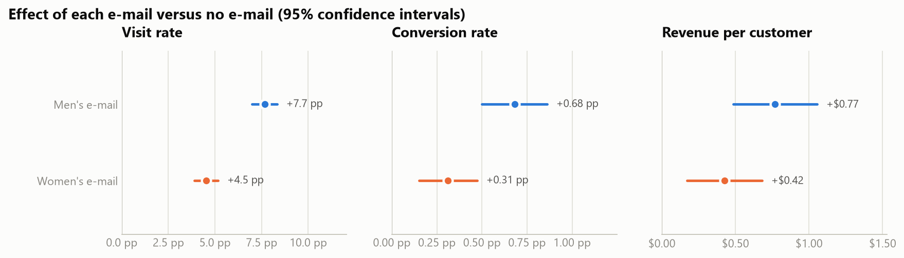
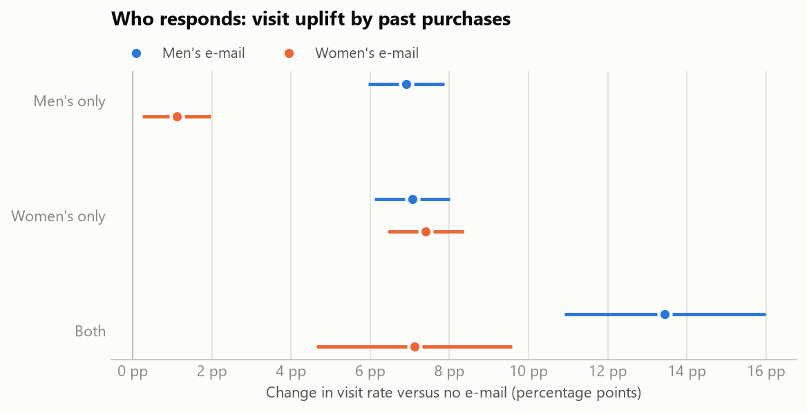
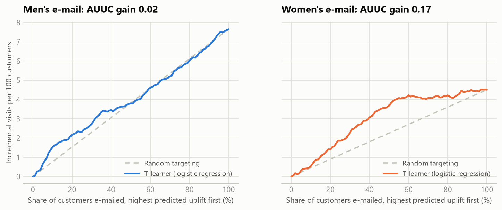
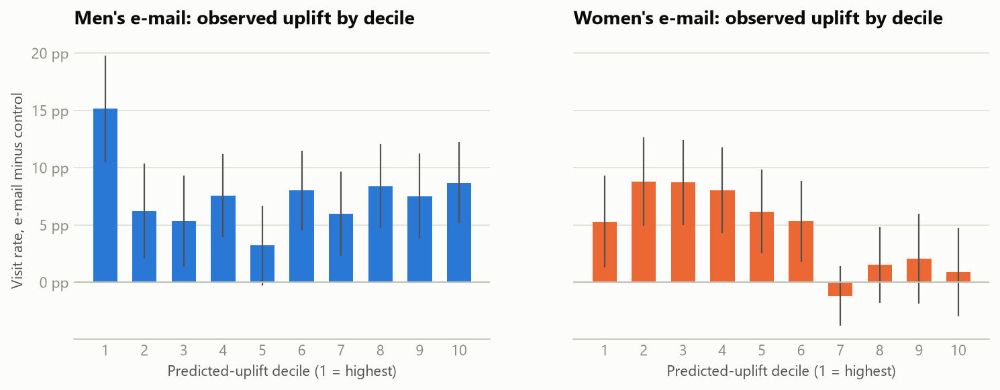

# Who should get the e-mail? A/B testing and uplift modelling

**[Live dashboard](https://mehtaaarush.github.io/ab-testing-uplift-modeling/)** · [Analysis notebook](notebooks/uplift_analysis.ipynb)

An end-to-end analysis of a randomised marketing experiment. 64,000 customers of an online retailer were split three ways: a men's
merchandise e-mail, a women's merchandise e-mail, or no e-mail, and their visits, purchases and spend were tracked for two weeks.
The project answers the three questions a marketing team would ask:

1. **Did the e-mails work, and by how much?** Classical A/B analysis with randomisation checks, confidence intervals and multiple-testing control.
2. **Who responds?** Heterogeneous effects by segment, then uplift models that predict each customer's response to each e-mail.
3. **Whom should we e-mail next time?** Off-policy evaluation of targeting rules, a cost-aware targeting simulator and a power calculator for the next test.

## Headline results

- **The men's e-mail lifted revenue by $0.77 per customer** (from $0.65 to $1.42 over two weeks, +118%; 95% CI $0.49–$1.05), visits by
  **+7.7 percentage points** (10.6% → 18.3%) and conversion by **+0.68 pp** (0.57% → 1.25%).
- **The women's e-mail worked too, but less well**: +4.5 pp visits, +0.31 pp conversion and +$0.42 revenue per customer.
  All six effects stay significant after Holm correction (largest adjusted p = 0.0011).
- **Randomisation checks out**: the arm sizes match the planned equal split (chi-square p = 0.90) and every pre-treatment covariate is balanced (all |SMD| ≤ 0.014).
- **An uplift model finds who the women's e-mail persuades.** On held-out customers, targeting the top 30% by predicted uplift captures **50% of
  the e-mail's extra visits** (AUUC gain 0.17, 95% CI 0.09–0.27). The model learned that the e-mail works almost only on customers who buy women's merchandise.
- **The men's e-mail works on everyone, so there is little to target** (AUUC gain 0.02, interval includes zero).
- **Recommendation: send the men's e-mail to the whole list.** Choosing the better e-mail per customer does not beat it
  (−4.7 visits per 1,000 customers, 95% CI −12.2 to +2.3). If sends must be cut, the women's e-mail should go only to women's-merchandise buyers.



## 1. Did the e-mails work?

| Comparison | Visit rate | Conversion rate | Revenue per customer |
|---|---|---|---|
| No e-mail (baseline) | 10.6% | 0.57% | $0.65 |
| **Men's e-mail** | **18.3%** (+7.7 pp, +72%) | **1.25%** (+0.68 pp, +119%) | **$1.42** (+$0.77, +118%) |
| Women's e-mail | 15.1% (+4.5 pp, +43%) | 0.88% (+0.31 pp, +54%) | $1.08 (+$0.42, +65%) |

Rates are compared with a two-proportion z-test, revenue with Welch's t-test, relative lifts carry delta-method intervals, and all six p-values are
Holm-adjusted as one family. Full results with intervals are in [reports/ab_test_results.csv](reports/ab_test_results.csv).

**Is the revenue result robust?** About 99% of customers spend nothing in two weeks and a few spend hundreds, so the t-interval is checked two ways.
A percentile bootstrap (4,000 resamples) gives $0.49–$1.05 for the men's e-mail, matching the t-interval. Lin's (2013) regression adjustment
with HC2 errors narrows the intervals by under 2%: past spend, recency, channel and area barely predict who buys within two weeks.

## 2. Who responds?



- The women's e-mail lifts visits by **+7.4 pp among women's-only buyers but just +1.1 pp among men's-only buyers**.
- The men's e-mail works for everyone: +6.9 pp for men's-only buyers, +7.1 pp for women's-only buyers and +13.4 pp for customers who buy both.
- Women's-only buyers are the one segment where the two e-mails tie. In the other 21 segments (by channel, area, tenure, recency and spend), the men's e-mail has the larger effect.

## 3. Uplift models

Uplift models predict, per customer, how much an e-mail changes the chance of visiting. Visits are the target because conversions (about 1%) are
too sparse to model reliably. Four learners were compared, one model per campaign (e-mail vs. no e-mail):

| Model | Women's e-mail: CV AUUC | Women's e-mail: hold-out AUUC (95% CI) | Men's e-mail: hold-out AUUC (95% CI) |
|---|---|---|---|
| **T-learner, logistic regression** (selected) | **0.180** | **0.171** (0.087–0.274) | 0.025 (−0.023–0.072) |
| S-learner, gradient boosting | 0.136 | 0.161 (0.086–0.268) | 0.032 (−0.016–0.087) |
| Class transformation, gradient boosting | 0.109 | 0.143 (0.060–0.243) | −0.020 (−0.065–0.027) |
| T-learner, gradient boosting | 0.111 | 0.137 (0.062–0.230) | 0.002 (−0.049–0.054) |

*AUUC gain is the average height of the uplift curve above the random-targeting line, as a share of the total effect (0 = no better than random).
The model is selected by five-fold cross-validated AUUC on the 70% training split; every hold-out number comes from the untouched 30%.*



The simplest learner generalised best. For the women's e-mail the curve rises steeply and then flattens: the model ranks women's-merchandise buyers
first (100% of its top 30% bought women's items, against 1% of its bottom 30%), and the e-mail adds almost nothing for the rest. For the men's e-mail
the curve hugs the diagonal, because the e-mail lifts every segment by a similar amount.



## 4. Which targeting policy should the business run?

Per-arm response models choose an e-mail (or none) for each customer. Because arms were randomised with known probabilities, inverse-propensity
weighting gives an unbiased estimate of what each policy would have produced on the hold-out customers:

| Policy | E-mails per 1,000 | Visits per 1,000 | Revenue per 1,000 | Visits vs. men's e-mail to everyone (95% CI) |
|---|---|---|---|---|
| No e-mail | 0 | 106 | $634 | −76.5 (−90.3 to −63.0) |
| Women's e-mail to everyone | 1,000 | 151 | $983 | −31.4 (−44.7 to −18.3) |
| **Men's e-mail to everyone** | 1,000 | **183** | **$1,529** | baseline |
| Best e-mail for each customer | 1,000 | 178 | $1,510 | −4.7 (−12.2 to +2.3) |
| Best e-mail, top half by predicted uplift | 500 | 150 | $1,066 | −32.4 (−43.2 to −22.0) |

Personalising the e-mail does not help: the women's e-mail is never clearly better than the men's for any segment. Targeting only the top half
keeps 58% of the extra visits with half the sends, which pays only when sends are expensive. The dashboard's simulator finds the best share to
e-mail for any value per visit and cost per send.

## Approach

| Step | Method |
|---|---|
| Data quality | SHA-256 check of the download; validation rules (no spend without a conversion, no conversion without a visit, valid arms) |
| Randomisation | Chi-square sample-ratio-mismatch test; standardised mean differences for 11 covariates |
| Average effects | Two-proportion z-test (Wald CI), Welch's t-test, delta-method CI for relative lift, Holm correction |
| Robustness | Percentile bootstrap; Lin (2013) fully interacted regression adjustment with HC2 errors |
| Heterogeneity | The same tests within segments (≥ 300 customers per arm) |
| Uplift models | T-learner and S-learner (histogram gradient boosting), class transformation (Jaskowski & Jaroszewicz, 2012), T-learner (logistic regression) |
| Model evaluation | Stratified 70/30 split, 5-fold CV AUUC for selection, hold-out uplift curves, deciles and bootstrap CIs |
| Policy evaluation | Inverse-propensity weighting with paired bootstrap intervals |
| Planning | Minimum detectable effect and sample-size calculator |

## Project structure

```
ab-testing-uplift-modeling/
├── uplift/
│   ├── config.py        # paths and constants
│   ├── data.py          # download (checksum), tidy, validate
│   ├── experiment.py    # SRM, balance, effects, Holm, bootstrap, Lin adjustment, segments, power
│   ├── models.py        # T-learner, S-learner, class transformation, per-arm response models
│   ├── evaluate.py      # uplift curves, AUUC, deciles, inverse-propensity policy values
│   ├── targeting.py     # CV model selection, hold-out evaluation, policy comparison
│   ├── export.py        # dashboard JSON
│   ├── figures.py       # README figures
│   └── pipeline.py      # python -m uplift.pipeline
├── tests/               # 21 tests on synthetic experiments with planted effects
├── notebooks/uplift_analysis.ipynb
├── reports/             # result tables and figures
└── docs/                # GitHub Pages dashboard (static HTML + Plotly)
```

## Reproduce

```bash
python -m venv .venv
.venv/Scripts/activate        # Windows; use `source .venv/bin/activate` on macOS/Linux
pip install -r requirements.txt
python -m uplift.pipeline     # downloads the data once (~4 MB), about a minute end to end
pytest
python -m http.server 8000 --directory docs   # then open http://localhost:8000
```

## Limitations

- One two-week campaign from 2008. Long-term effects such as unsubscribes, fatigue and repeat purchases are not observed.
- Revenue is too sparse for a reliable per-customer revenue model, so targeting is driven by visits. The simulator values a visit at the
  campaign's average incremental revenue per incremental visit (about $9–10).
- Segment results are exploratory: 22 segments × 2 e-mails is many comparisons, so single segments with wide intervals should not drive decisions.

## Data and license

Data: Kevin Hillstrom, [MineThatData E-Mail Analytics and Data Mining Challenge](https://blog.minethatdata.com/2008/03/minethatdata-e-mail-analytics-and-data.html) (2008),
downloaded on first run and not redistributed here. Code: MIT License.
